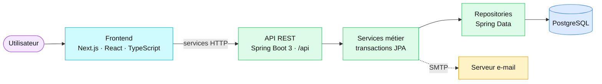
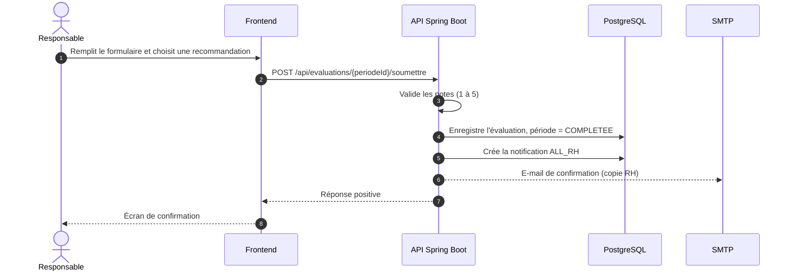
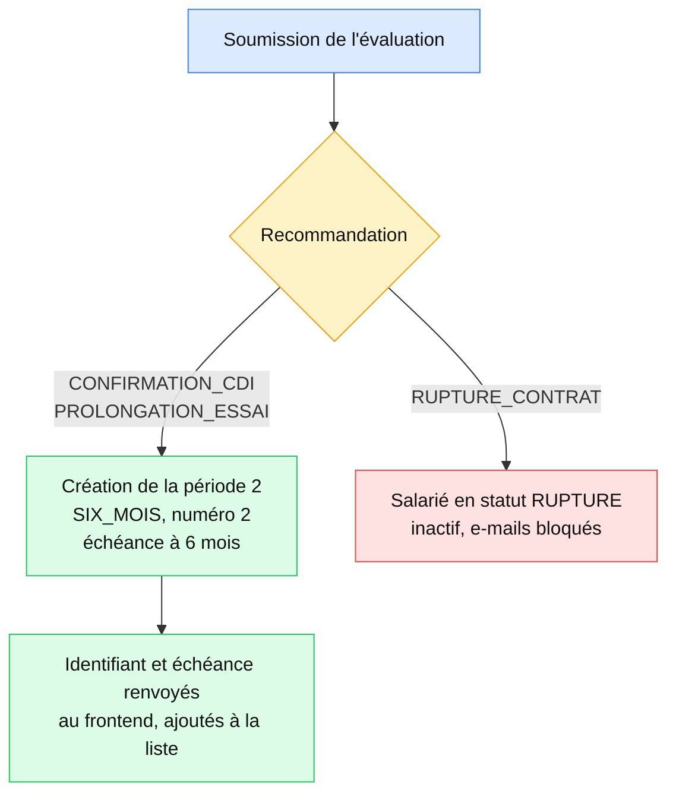
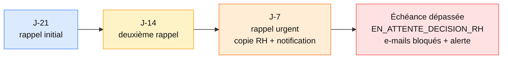

# Documentation technique


Documentation technique de **Premium Ressources Humaines Manager**, l'application de suivi RH des périodes d'essai du Groupe Premium.

## Sommaire

1. [Objectif et périmètre](#1-objectif-et-périmètre)
2. [Stack et structure](#2-stack-et-structure)
3. [Parcours du salarié et des évaluations](#3-parcours-du-salarié-et-des-évaluations)
4. [Notifications RH et e-mails](#4-notifications-rh-et-e-mails)
5. [Échéances automatisées](#5-échéances-automatisées)
6. [API utilisées par l'interface](#6-api-utilisées-par-linterface)
7. [Configuration locale](#7-configuration-locale)
8. [Tests et contrôles](#8-tests-et-contrôles)
9. [Sécurité et déploiement](#9-sécurité-et-déploiement)
10. [Mode démo et limites de persistance](#10-mode-démo-et-limites-de-persistance)

## 1. Objectif et périmètre

**Premium Ressources Humaines Manager** accompagne le suivi RH des périodes d'essai. Le frontend est une application Next.js ; l'API métier est un service Spring Boot qui utilise PostgreSQL avec Spring Data JPA.

Les flux salariés, évaluations et notifications documentés ci-dessous sont reliés au backend. L'application contient également des vues de démonstration et des données conservées uniquement dans le navigateur.

> [!NOTE]
> Le stockage `localStorage` ne remplace pas PostgreSQL. Il n'est ni partagé entre utilisateurs ni synchronisé automatiquement avec le serveur.

## 2. Stack et structure



| Composant | Emplacement | Technologie / rôle |
| --- | --- | --- |
| Interface web | `frontend/src/app/`, `frontend/src/components/` | Next.js App Router, React, TypeScript |
| État partagé | `frontend/src/context/AppContext.tsx` | React Context ; données UI, appels API et mode démo |
| Services frontend | `frontend/src/services/` | Clients HTTP pour salariés, évaluations, notifications et dashboard |
| API REST | `backend/src/main/java/com/premium/essai/controller/` | Spring Boot 3, contexte `/api` |
| Logique métier | `backend/src/main/java/com/premium/essai/service/` | Services Spring et transactions JPA |
| Modèle et persistance | `backend/src/main/java/com/premium/essai/model/`, `repository/` | Entités JPA et repositories Spring Data |
| Base de données | `backend/src/main/resources/application.yaml` | PostgreSQL pour l'exécution locale |
| Tests backend | `backend/src/test/` | JUnit, Spring Boot Test et H2 |

Versions : Java 17 (`backend/pom.xml`) ; Bun, Next.js 16, React 19 et TypeScript 5 (`frontend/package.json`).

## 3. Parcours du salarié et des évaluations

### 3.1 Création du salarié et période 1

Le formulaire d'ajout appelle `salarieService.createSalarie()`, qui envoie un `POST /api/salaries` au backend.

Le service `SalarieServiceImpl` :

1. vérifie et associe la direction et le responsable ;
2. crée le salarié actif avec le statut `EN_COURS` ;
3. calcule la date de fin prévisionnelle à six mois ;
4. crée la période 1 (`TROIS_MOIS`, numéro `1`) avec une échéance à trois mois après l'embauche ;
5. renvoie les identifiants du salarié et de la période initiale au frontend.

Le frontend remplace les identifiants provisoires de son état par les identifiants générés par PostgreSQL. Cela permet au formulaire d'évaluation d'utiliser l'identifiant de période attendu par l'API.

### 3.2 Soumission par le responsable

Dans `FormulaireEvaluationScreen`, le bouton de soumission reste désactivé tant que le responsable n'a pas choisi l'une des recommandations suivantes :

| Choix dans l'interface | Valeur transmise à l'API |
| --- | --- |
| Renouvellement | `PROLONGATION_ESSAI` |
| Titularisation | `CONFIRMATION_CDI` |
| Arrêt de contrat | `RUPTURE_CONTRAT` |

Le choix est la recommandation du responsable, pas une décision de validation RH. Le backend valide les notes (de 1 à 5), enregistre les notes, les commentaires et les réponses détaillées en JSON, puis passe la période évaluée au statut `COMPLETEE`. Une seconde soumission pour la même période est refusée.

> [!IMPORTANT]
> Si l'API renvoie une erreur ou ne répond pas, le frontend affiche l'erreur et ne présente pas l'écran de confirmation. Le succès n'est affiché qu'après la réponse positive du backend.



### 3.3 Suite du cycle



- Pour `CONFIRMATION_CDI` et `PROLONGATION_ESSAI` sur une période de trois mois, `EvaluationServiceImpl` crée la période 2 (`SIX_MOIS`, numéro `2`) avec une échéance à six mois après la date d'embauche.
- Pour une recommandation de rupture, le salarié passe à l'état `RUPTURE`, devient inactif et ses e-mails sont bloqués.
- Une décision RH finale est un processus distinct de la recommandation du responsable.

## 4. Notifications RH et e-mails

À la soumission d'une évaluation, le backend crée une notification persistée avec la cible `ALL_RH`. Le frontend la charge depuis l'API et la présente dans le centre de notifications. Les actions « marquer comme lue » et « tout marquer comme lu » sont également envoyées à l'API.

| Méthode | Endpoint | Rôle |
| --- | --- | --- |
| `GET` | `/api/notifications` | Lire les notifications destinées à la RH |
| `PATCH` | `/api/notifications/{id}/read` | Marquer une notification comme lue |
| `PATCH` | `/api/notifications/read-all` | Marquer les notifications RH comme lues |

Après la soumission, un e-mail de confirmation est envoyé au responsable avec une copie à l'adresse RH configurée.

> [!NOTE]
> L'échec SMTP est journalisé ; il ne signifie pas que la notification en base n'a pas été créée. Il faut configurer `MAIL_USERNAME` et `MAIL_PASSWORD` pour que l'envoi d'e-mails fonctionne.

## 5. Échéances automatisées

`NotificationEcheanceService` exécute le traitement planifié du lundi au vendredi à 09:00, fuseau `Africa/Casablanca`. Le traitement ignore les week-ends et les jours fériés marocains prévus dans le service.



| Étape | Action |
| --- | --- |
| J-21 | Rappel initial |
| J-14 | Deuxième rappel |
| J-7 | Rappel urgent, copie à la RH et notification dans l'application |
| Après l'échéance | Le dossier passe en `EN_ATTENTE_DECISION_RH`, le salarié est bloqué pour les e-mails et une alerte est créée |

Le formulaire du responsable refuse la soumission lorsque l'échéance est dépassée ou que la période est déjà en attente d'une décision RH. La régularisation doit alors suivre le circuit RH.

## 6. API utilisées par l'interface

Le frontend utilise par défaut `http://localhost:8080/api`. La variable `NEXT_PUBLIC_API_URL` peut définir une autre URL pour les services frontend qui la prennent en charge.

| Méthode | Endpoint | Utilisation |
| --- | --- | --- |
| `GET` / `POST` | `/api/salaries` | Charger les salariés actifs / créer un salarié et sa période 1 |
| `POST` | `/api/evaluations/{periodeId}/soumettre` | Enregistrer une évaluation et déclencher le flux de notification / période suivante |
| `GET` | `/api/evaluations/access/{token}` | Accès sécurisé au formulaire par jeton |
| `GET` | `/api/evaluations/periode/{periodeId}` | Lire le détail d'une évaluation |
| `GET` | `/api/notifications` | Charger les notifications RH |
| `PATCH` | `/api/notifications/{id}/read` | Marquer une notification comme lue |
| `PATCH` | `/api/notifications/read-all` | Marquer toutes les notifications RH comme lues |
| `GET` | `/api/dashboard/stats` | Charger les statistiques du tableau de bord |
| `GET` | `/api/dashboard/audit-emails` | Charger l'historique des e-mails |

> [!NOTE]
> Les routes Next.js présentes dans `frontend/src/app/api/` ne remplacent pas toutes ces routes métier. Certaines sont encore des points de terminaison de démonstration ; vérifier les services frontend avant d'utiliser une ressource en production.

## 7. Configuration locale

### PostgreSQL

Créer une base appelée `premium_essai_db`, puis vérifier la section `spring.datasource` dans `backend/src/main/resources/application.yaml`. La configuration actuelle vise `localhost:5432`. Les paramètres d'accès PostgreSQL sont définis dans ce fichier ; les variables `DB_URL`, `DB_USERNAME` et `DB_PASSWORD` d'un fichier `.env` ne sont pas utilisées par cette configuration actuelle.

> [!WARNING]
> Ne publiez aucun mot de passe ni secret. `backend/.env` est une configuration locale et ne doit pas être copiée dans la documentation.

### SMTP

Le backend lit les identifiants mail depuis `MAIL_USERNAME` et `MAIL_PASSWORD`. Le serveur SMTP est configuré dans `application.yaml`.

### Frontend

Les services frontend utilisent `NEXT_PUBLIC_API_URL` ou, si elle n'est pas définie, `http://localhost:8080/api`. Pour le développement local, le backend autorise les origines `http://localhost:3000` et `http://127.0.0.1:3000` par CORS.

### Démarrage sous Windows / PowerShell

Depuis la racine du dépôt, lancer le backend :

```powershell
Set-Location backend
.\mvnw.cmd spring-boot:run
```

Dans un second terminal, lancer le frontend :

```powershell
Set-Location frontend
bun install
bun run dev
```

| Service | Adresse locale |
| --- | --- |
| Application | `http://localhost:3000` |
| API | `http://localhost:8080/api` |
| Swagger UI | `http://localhost:8080/swagger-ui/index.html` |

Si Spring Boot signale que le port 8080 est déjà utilisé, identifier le processus à l'écoute avant d'agir, ou choisir un autre `server.port`.

## 8. Tests et contrôles

Tests backend :

```powershell
Set-Location backend
.\mvnw.cmd test
```

Vérification des types frontend :

```powershell
Set-Location frontend
bunx tsc --noEmit
```

Les tests backend utilisent H2 en mémoire via `backend/src/test/resources/application-test.yaml` ; ils ne nécessitent pas de connexion à PostgreSQL.

## 9. Sécurité et déploiement

> [!WARNING]
> La configuration actuelle de Spring Security autorise les requêtes sans authentification et le sélecteur de rôle frontend ne protège pas les données. La configuration CORS est limitée aux origines locales. Cette application ne doit pas être exposée avec des données RH réelles avant la mise en place d'une authentification, d'autorisations côté serveur, de secrets fournis par l'environnement et d'origines CORS de production explicitement approuvées.

Le frontend peut être hébergé séparément, mais une URL `localhost` ne fonctionnera pas pour les utilisateurs d'un site public. Déployer également l'API et configurer `NEXT_PUBLIC_API_URL`, PostgreSQL, SMTP et CORS pour les domaines réels.

## 10. Mode démo et limites de persistance

Le mode démo s'appuie sur les jeux de données définis dans `frontend/src/data/mockData.ts`. Certaines données et préférences UI sont conservées dans `localStorage`. Elles restent dans le navigateur local et ne sont pas visibles par les autres utilisateurs.

Pour les parcours branchés au backend, les données serveur font foi. En mode démo, les données d'exemple ne doivent pas être interprétées comme des enregistrements PostgreSQL.

> [!TIP]
> Pour toute nouvelle fonctionnalité, vérifier qu'elle possède un endpoint Spring Boot, un service frontend qui appelle cet endpoint et un test couvrant la persistance attendue.
