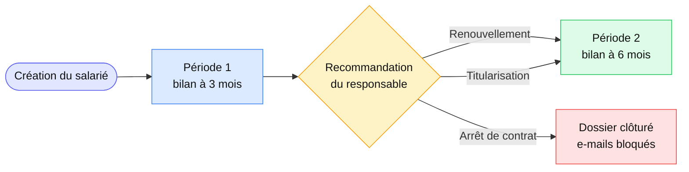
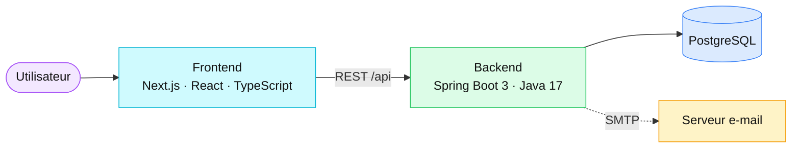
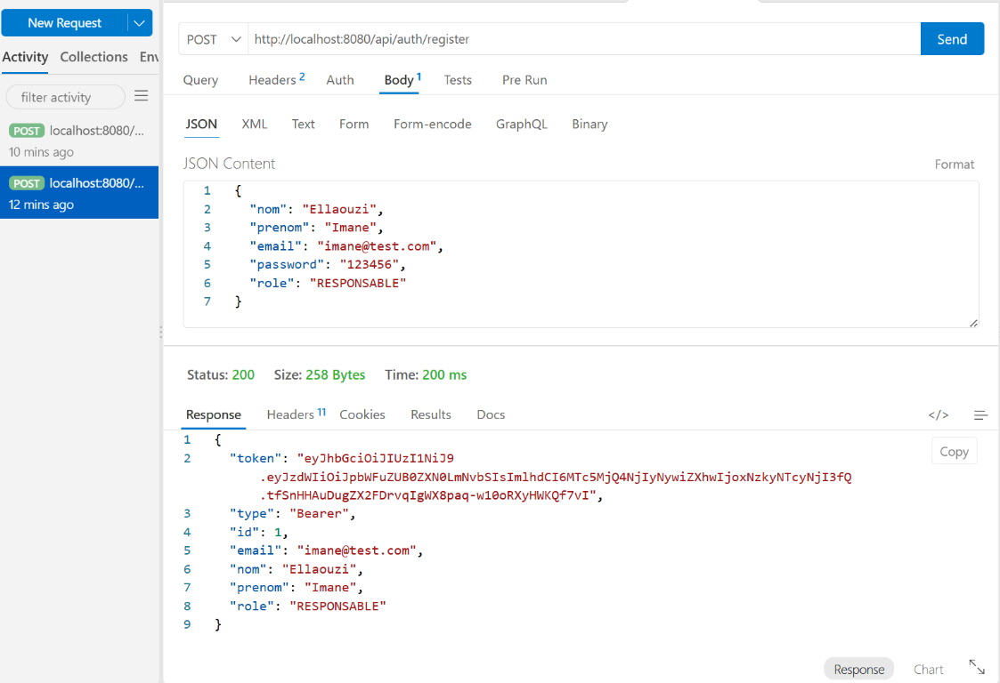
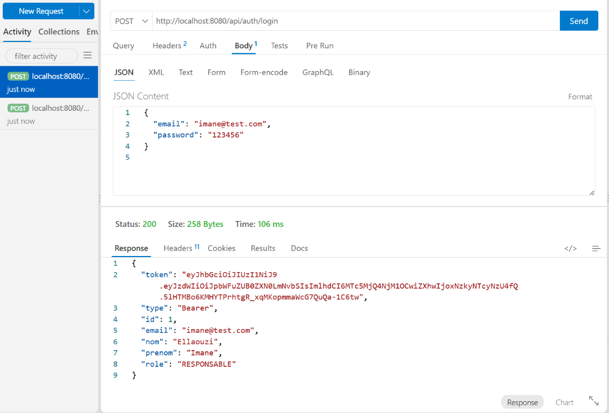

# Premium Essai Manager

<p>
  
</p>

Application de suivi des périodes d'essai du Groupe Premium. Elle aide les équipes RH et les responsables à planifier les bilans, enregistrer les évaluations et suivre les décisions concernant les collaborateurs.

## Sommaire

- [Premium Essai Manager](#premium-essai-manager)
  - [Sommaire](#sommaire)
  - [Fonctionnalités](#fonctionnalités)
  - [Parcours d'évaluation](#parcours-dévaluation)
  - [Architecture](#architecture)
  - [Prérequis](#prérequis)
  - [Démarrage en local](#démarrage-en-local)
    - [1. Préparer PostgreSQL](#1-préparer-postgresql)
    - [2. Démarrer le backend](#2-démarrer-le-backend)
    - [3. Démarrer le frontend](#3-démarrer-le-frontend)
  - [Configuration](#configuration)
  - [API Testing (Thunder Client)](#api-testing-thunder-client)
    - [1. User Registration](#1-user-registration)
    - [2. User Authentication](#2-user-authentication)
  - [Vérification](#vérification)
  - [Déploiement et limites connues](#déploiement-et-limites-connues)
  - [Documentation](#documentation)


## Fonctionnalités

- Répertoire des salariés et suivi de leurs périodes d'essai.
- Échéances calculées à partir de la date d'embauche : bilan à 3 mois (période 1), puis bilan à 6 mois (période 2).
- Formulaire d'évaluation avec notes par catégorie, commentaires et recommandation du responsable.
- Notifications RH enregistrées en base lors de la soumission d'une évaluation.
- Rappels planifiés les jours ouvrables à 09 h, heure de Casablanca : J-21, J-14 et J-7.
- Blocage de la soumission par le responsable après l'échéance, avec passage du dossier en attente de décision RH.
- Tableau de bord, historique des e-mails et centre de notifications.
- Mode démo avec jeux de données d'exemple.

## Parcours d'évaluation



1. La création d'un salarié génère une période 1, prévue à trois mois.
2. Le responsable complète le formulaire et doit choisir une recommandation : **Renouvellement**, **Titularisation** ou **Arrêt de contrat**. Le bouton de soumission reste désactivé tant qu'aucun choix n'est fait.
3. La soumission est envoyée à l'API Spring Boot et enregistrée en base. La période évaluée passe au statut `COMPLETEE`. Une notification destinée à la RH est créée et apparaît dans le centre de notifications.
4. Pour les recommandations de renouvellement ou de titularisation, une période 2 à six mois est créée automatiquement et ajoutée à la liste des périodes. La recommandation est un avis du responsable ; elle ne remplace pas une validation RH.
5. Pour un arrêt de contrat, le dossier du salarié est clôturé et ses futurs e-mails sont bloqués.

## Architecture



| Couche | Technologies |
| --- | --- |
| Interface | Next.js App Router, React, TypeScript, Tailwind CSS |
| API métier | Java 17, Spring Boot 3, Spring Data JPA |
| Base de données | PostgreSQL |
| Tests backend | Maven, JUnit, H2 |
| Gestionnaire frontend | Bun (version indiquée dans `frontend/package.json`) |

Le frontend utilise `AppContext` pour l'état partagé. Les appels métier déjà reliés au backend passent par des services dans `frontend/src/services/`. PostgreSQL est la source persistante des opérations effectivement envoyées à Spring Boot.

> [!NOTE]
> Certaines vues et fonctions restent en mode local/démo : `localStorage` n'est pas une sauvegarde partagée entre utilisateurs ni un remplacement de la base de données.

## Prérequis

- Java 17.
- PostgreSQL disponible localement ou sur un serveur accessible.
- Bun installé pour le frontend.

## Démarrage en local

### 1. Préparer PostgreSQL

Créer la base `premium_essai_db`, puis vérifier les paramètres de connexion dans `backend/src/main/resources/application.yaml`. Le fichier actuel cible PostgreSQL local sur le port `5432`. Adaptez l'URL et les identifiants à votre environnement si nécessaire.

### 2. Démarrer le backend

Depuis PowerShell, à la racine du dépôt :

```powershell
Set-Location backend
.\mvnw.cmd spring-boot:run
```

L'API est disponible à `http://localhost:8080/api`. Si le port 8080 est déjà occupé, arrêtez uniquement le processus que vous avez identifié ou modifiez `server.port` dans `application.yaml`.

### 3. Démarrer le frontend

Dans un autre terminal, à la racine du dépôt :

```powershell
Set-Location frontend
bun install
bun run dev
```

Ouvrir `http://localhost:3000`.

## Configuration

- `frontend/src/services/` utilise `NEXT_PUBLIC_API_URL` si la variable est définie ; sinon l'URL par défaut est `http://localhost:8080/api`.
- La configuration PostgreSQL active est définie dans `backend/src/main/resources/application.yaml`. Vérifiez-la avant de lancer l'application ; ne mettez pas de mots de passe réels dans Git.
- Les identifiants SMTP sont lus depuis `MAIL_USERNAME` et `MAIL_PASSWORD`. Une erreur SMTP n'empêche pas nécessairement l'enregistrement de la notification dans l'application, mais l'e-mail ne sera pas livré.
- Variables d'environnement du backend :

  | Variable | Rôle |
  | --- | --- |
  | `JWT_SECRET` | Secret de signature des sessions (32 caractères minimum). **Obligatoire en production** : sans valeur, un secret aléatoire est généré à chaque démarrage et les sessions sont perdues au redémarrage. |
  | `JWT_EXPIRATION_HOURS` | Durée de validité d'une session (12 par défaut). |
  | `ADMIN_BOOTSTRAP_EMAIL` / `ADMIN_BOOTSTRAP_PASSWORD` | Création du **premier** Admin RH, uniquement si aucun n'existe. Le changement de mot de passe est exigé à la première connexion ; retirez ensuite ces variables. Les autres admins sont invités depuis l'écran « Administrateurs ». |
  | `MAIL_USERNAME` / `MAIL_PASSWORD` | Compte SMTP d'envoi des e-mails. |
  | `MAIL_SENDER` | Adresse d'expéditeur par défaut (sinon `MAIL_USERNAME`). Modifiable ensuite dans Paramètres. |
  | `FRONTEND_URL` | URL publique du frontend, utilisée dans les liens des e-mails. |

- **Modèles d'e-mail RH** (rappels J-21, J-14, J-7 et retard) : l'Admin RH les modifie dans *Paramètres → Relances*. Les changements sont enregistrés en base et utilisés dès le prochain envoi ; « Rétablir le texte par défaut » restaure le texte d'origine. Champs disponibles : `{nom_manager}`, `{nom_salarie}`, `{date_echeance}`, `{date_limite}`, `{lien_evaluation}`, `{lien_application}`, `{identifiant}`, `{jours_retard}` (un champ inconnu est refusé). Le mot de passe n'est jamais envoyé par e-mail.
- Variables du frontend : `NEXT_PUBLIC_SUPPORT_NOM`, `NEXT_PUBLIC_SUPPORT_ROLE` et `NEXT_PUBLIC_SUPPORT_EMAIL` définissent le contact affiché dans l'écran Aide. `OPENAI_API_KEY` (et `OPENAI_MODEL`) active l'analyse IA ; sans clé, l'analyse est signalée comme « indicative » (modèle générique). La route d'analyse exige d'être connecté.
- Variable du frontend : `NEXT_PUBLIC_ENABLE_DEMO=true` affiche le bouton « Mode Démo » (données fictives de présentation). Ne la définissez jamais en production.
- L'API Spring configure CORS pour le frontend local `http://localhost:3000` et `http://127.0.0.1:3000`. Pour un autre domaine, configurez explicitement une origine de confiance côté backend.

> [!IMPORTANT]
> `backend/.env` est un fichier local de configuration : ne copiez jamais ses secrets dans une documentation, un ticket ou un dépôt public.

##  API Testing (Thunder Client)

Les captures ci-dessous montrent des requêtes Thunder Client réussies avec des données de démonstration. Le mot de passe et le jeton JWT visibles dans les captures sont fictifs et réservés aux tests locaux ; ne réutilisez jamais ces exemples avec un compte ou un environnement réel.

### 1. User Registration

Dans Thunder Client, créez une requête **POST** vers `http://localhost:8080/api/auth/register` avec le corps JSON suivant :

```json
{
  "nom": "Nom",
  "prenom": "Prenom",
  "email": "user@example.com",
  "password": "REPLACE_WITH_A_STRONG_PASSWORD",
  "role": "RESPONSABLE"
}
```

Les rôles acceptés sont `ADMIN_RH` et `RESPONSABLE`.



### 2. User Authentication

Envoyez une requête **POST** à `http://localhost:8080/api/auth/login` avec le corps JSON suivant :

```json
{
  "email": "user@example.com",
  "password": "REPLACE_WITH_A_STRONG_PASSWORD"
}
```

La connexion doit être envoyée en **POST** depuis Thunder Client (ou un autre client HTTP), et non en ouvrant cette URL dans un navigateur, qui envoie une requête **GET**.



## Vérification

Tests backend :

```powershell
Set-Location backend
.\mvnw.cmd test
```

Vérification TypeScript du frontend :

```powershell
Set-Location frontend
bunx tsc --noEmit
```

## Déploiement et limites connues

La configuration par défaut vise un environnement local. En déploiement, définissez l'URL publique de l'API avec `NEXT_PUBLIC_API_URL`, configurez PostgreSQL et SMTP avec des secrets gérés par l'environnement, et autorisez uniquement les domaines frontend nécessaires dans CORS.

> [!WARNING]
> La sécurité backend actuelle autorise les requêtes sans authentification ; le sélecteur de rôle de l'interface ne constitue pas un contrôle d'accès. Ne déployez pas l'application avec des données personnelles réelles avant d'avoir mis en place une authentification et une autorisation adaptées.

Les listes d'autres ressources ou certaines actions de l'interface peuvent encore utiliser les données de démonstration ou le stockage local. Vérifiez que le parcours concerné est relié à l'API avant de compter sur une persistance en base.

## Documentation

- [Documentation technique et flux métier](./DOCUMENTATION_TECHNIQUE.md)
- [Documentation de l'API (Swagger)](http://localhost:8080/swagger-ui/index.html) lorsque le backend local est démarré.
- [Spécification OpenAPI du frontend](./frontend/public/openapi.json)
